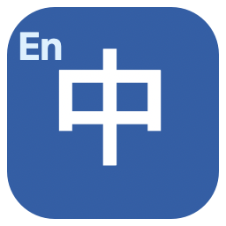

# 英译中文 · EnglishHanZi

一款**离线 macOS 中文输入法**：直接键入英文单词，从候选中选出中文。默认输出繁体中文，可在输入法菜单中切换简体中文。



## 快速开始

需要 macOS 和 Apple Command Line Tools（`clang`、`codesign`、`python3`）。项目已经附带离线词库，正常构建和使用均不需要联网。

```sh
./Scripts/install.sh
```

安装后，打开 **系统设置 → 键盘 → 输入源 → 编辑 → 添加**，搜索“英译中文”并添加。然后在菜单栏的输入法菜单中选择它。安装脚本会尝试注册和启用；是否已启用可以用下面的命令核对：

```sh
"$HOME/Library/Input Methods/EnglishHanZi.app/Contents/MacOS/EnglishHanZi" --status
```

如果 macOS 未立即列出新输入法，退出登录后重新登录，再到输入源里查找。

## 输入方式

| 操作 | 结果 |
| --- | --- |
| `hello` + 空格 | 输入“你好” |
| `computer` + 空格 | 输入“電腦”（繁体模式） |
| `good-morning` + 空格 | 输入“早上好”；用 `-` 连接英文短语里的单词 |
| 数字 `1`–`9` | 选择对应候选 |
| `↑`、`↓` 后按空格 | 移动并提交高亮候选 |
| 退格 | 修改尚未上屏的英文 |
| `0`、`Tab` 或 `Esc` | 原样输入尚未上屏的英文 |
| `Shift` + 空格 | 在中文转换与直接英文之间切换 |
| 输入法菜单 | 切换繁简体、切换直接英文 |

输入时会展示完整词或前缀建议；单词不在词库中时，按空格会原样输入英文并保留空格。标点符号由当前应用处理。已选择的候选会在本机记忆，并影响后续排序。

## 词库与隐私

词库有 **79,188 个英文键、134,314 个中文候选**，来源是 [ECDICT](https://github.com/skywind3000/ECDICT) 和本项目的[高频优先词条](Resources/core.tsv)。ECDICT 依据 [MIT 许可证](Resources/ECDICT-LICENSE.txt)分发；数据库记录了[固定的上游版本和 SHA-256](Tools/build_dictionary.py)。

输入法运行时不联网。它只把选词次数保存在 macOS 的本机偏好设置中，不记录未选择的输入，也不上传文本。词库是词与短语的翻译，并非整句机器翻译；遇到多义词时应看候选。非人工校订词条的繁体由系统文字转换，台湾地区的习惯说法可能与优先词条不同。

## 开发

```sh
./Scripts/build.sh       # build/EnglishHanZi.app
./Scripts/test.sh        # 词库、查词、签名检查
```

用命令行检查候选：

```sh
./build/EnglishHanZi.app/Contents/MacOS/EnglishHanZi --lookup hello
./build/EnglishHanZi.app/Contents/MacOS/EnglishHanZi --lookup-simplified computer
```

首次重新生成词库时需要下载固定版本的 ECDICT：

```sh
python3 Tools/build_dictionary.py
```

开发者可通过 `CODESIGN_IDENTITY` 指定本机签名身份；缺省使用临时签名。对外分发需使用适当的 Developer ID 签名与 Apple 公证。

项目代码使用 [MIT 许可证](LICENSE)。ECDICT 的许可证文本随输入法 bundle 一同分发。
